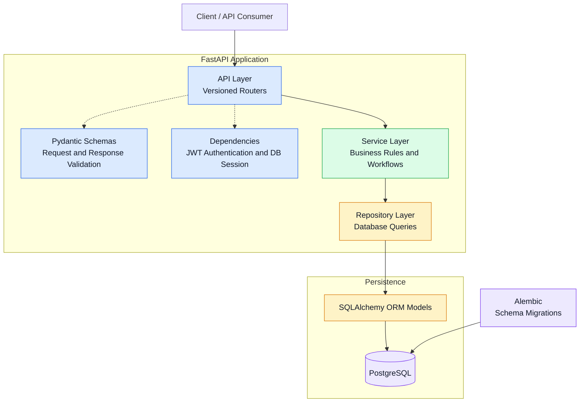

# E-commerce Backend API

A production-oriented REST API for an e-commerce platform, built with **Python, FastAPI, PostgreSQL, and SQLAlchemy 2.0 Async ORM**. The project demonstrates layered backend architecture, JWT-based authentication, database migrations, inventory-aware cart and order workflows, standardized API errors, and integration testing.


> **Test status:** The latest test run reported in the project development notes was **94 passing tests** and **86% overall coverage**. Update these figures whenever you run a newer full test and coverage report.

---

## Contents

- [Overview](#overview)
- [Features](#features)
- [Technology Stack](#technology-stack)
- [Architecture](#architecture)
- [Database Design](#database-design)
- [Project Structure](#project-structure)
- [API Overview](#api-overview)
- [Getting Started](#getting-started)
- [Environment Configuration](#environment-configuration)
- [Database Migrations](#database-migrations)
- [Running the API](#running-the-api)
- [Running Tests](#running-tests)
- [API Documentation](#api-documentation)
- [Error Handling](#error-handling)
- [Development Notes](#development-notes)

## Overview

The E-commerce Backend API provides the backend functionality required by a typical online store. It exposes versioned REST endpoints for user authentication, product and category operations, shopping carts, and order processing.

The codebase is organized into API, service, repository, and persistence layers. Asynchronous database access is implemented with SQLAlchemy 2.0 and `asyncpg`, while Alembic manages schema migrations.

## Features

- **Authentication:** User registration and login with JWT Bearer access tokens.
- **User operations:** Authenticated user profile access.
- **Product management:** Product creation, retrieval, updates, soft deletion, filtering, searching, sorting, and pagination.
- **Category management:** Category creation, retrieval, updates, listing, and soft deletion.
- **Shopping cart:** Add products, update quantities, remove items, and clear a cart.
- **Cart validation:** Checks product availability and stock limits, including combined quantities for an existing cart item.
- **Order processing:** Order creation, retrieval, listing, cancellation, and inventory-related business rules.
- **Inventory handling:** Stock validation during cart and order workflows, with inventory restoration on order cancellation.
- **API validation:** Pydantic request and response schemas.
- **Consistent errors:** RFC 9457 Problem Details responses using `application/problem+json`.
- **Database migrations:** Version-controlled schema changes with Alembic.
- **Automated tests:** Async API integration tests using pytest and HTTPX.
- **Containerized database:** PostgreSQL development environment using Docker Compose.

## Technology Stack

| Area | Technology |
|---|---|
| Language | Python |
| API framework | FastAPI |
| Database | PostgreSQL |
| ORM | SQLAlchemy 2.0 Async ORM |
| Async PostgreSQL driver | asyncpg |
| Data validation / settings | Pydantic v2 / pydantic-settings |
| Migrations | Alembic |
| Authentication | JWT Bearer tokens |
| Testing | pytest, HTTPX, AnyIO |
| Coverage | pytest-cov |
| Containers | Docker, Docker Compose |
| Version control | Git |

## Architecture

The application follows a layered architecture. HTTP concerns are handled by the API routers, business rules live in services, and repositories encapsulate database queries. SQLAlchemy models map application entities to PostgreSQL tables.



### Layer responsibilities

| Layer | Responsibility | Location |
|---|---|---|
| API | HTTP routes, status codes, and request handling | `app/api/` |
| Schemas | Request validation and response serialization | `app/schemas/` |
| Dependencies | Authentication and dependency injection | `app/dependencies/` |
| Services | Business logic and workflow coordination | `app/services/` |
| Repositories | Database access and query operations | `app/repositories/` |
| Models | SQLAlchemy ORM entities and relationships | `app/models/` |
| Database | Async engine, sessions, and declarative base | `app/database/` |
| Migrations | Database schema versioning | `migrations/` |

## Database Design

The database is organized around users, catalog data, carts, and orders. The following relationship diagram is a high-level view of the principal entities; it is not intended to replace the SQLAlchemy models or Alembic migration definitions.

```mermaid
erDiagram
    USER {
        UUID id PK
        string email
        string username
        string hashed_password
        boolean is_active
    }

    CATEGORY {
        UUID id PK
        string name
    }

    PRODUCT {
        UUID id PK
        UUID category_id FK
        string name
        string sku
        decimal price
        integer stock_quantity
        boolean is_active
    }

    CART {
        UUID id PK
        UUID user_id FK
    }

    CART_ITEM {
        UUID id PK
        UUID cart_id FK
        UUID product_id FK
        integer quantity
    }

    ORDER {
        UUID id PK
        UUID user_id FK
    }

    ORDER_ITEM {
        UUID id PK
        UUID order_id FK
        UUID product_id FK
        integer quantity
    }

    USER ||--o| CART : owns
    USER ||--o{ ORDER : places
    CATEGORY ||--o{ PRODUCT : categorizes
    CART ||--o{ CART_ITEM : contains
    PRODUCT ||--o{ CART_ITEM : referenced_by
    ORDER ||--|{ ORDER_ITEM : contains
    PRODUCT ||--o{ ORDER_ITEM : referenced_by
```



### Relationship summary

- A user has one shopping cart and can place multiple orders.
- A category can contain multiple products.
- A cart contains cart items; each cart item references a product.
- An order contains order items; each order item references a product.

## Project Structure

```text
ecommerce_backend/
├── app/
│   ├── api/
│   │   ├── responses.py
│   │   └── v1/
│   │       ├── auth.py
│   │       ├── cart.py
│   │       ├── category.py
│   │       ├── orders.py
│   │       ├── products.py
│   │       ├── router.py
│   │       └── users.py
│   ├── core/
│   │   ├── config.py
│   │   ├── exception_handlers.py
│   │   ├── logging.py
│   │   └── security.py
│   ├── database/
│   │   ├── base.py
│   │   ├── database.py
│   │   └── session.py
│   ├── dependencies/
│   ├── exceptions/
│   ├── models/
│   ├── repositories/
│   ├── schemas/
│   ├── services/
│   ├── utils/
│   └── main.py
├── migrations/
│   └── versions/
├── tests/
│   ├── conftest.py
│   ├── test_auth.py
│   ├── test_categories.py
│   ├── test_errors.py
│   ├── test_health.py
│   └── test_products.py
├── .env.example
├── alembic.ini
├── docker-compose.yml
├── pytest.ini
├── requirements.txt
└── README.md
```

## API Overview

All versioned endpoints are mounted under `/api/v1`.

| Resource | Method | Endpoint | Purpose |
|---|---|---|---|
| Authentication | POST | `/api/v1/auth/register` | Register a user |
| Authentication | POST | `/api/v1/auth/login` | Authenticate and obtain tokens |
| Users | GET | `/api/v1/users/me` | Get the authenticated user's profile |
| Products | GET | `/api/v1/products` | List and filter products |
| Products | POST | `/api/v1/products` | Create a product |
| Products | GET | `/api/v1/products/{product_id}` | Retrieve a product |
| Products | PATCH | `/api/v1/products/{product_id}` | Update a product |
| Products | DELETE | `/api/v1/products/{product_id}` | Soft-delete a product |
| Categories | GET | `/api/v1/categories` | List categories |
| Categories | POST | `/api/v1/categories` | Create a category |
| Categories | GET | `/api/v1/categories/{category_id}` | Retrieve a category |
| Categories | PATCH | `/api/v1/categories/{category_id}` | Update a category |
| Categories | DELETE | `/api/v1/categories/{category_id}` | Soft-delete a category |
| Cart | GET | `/api/v1/cart` | Retrieve the current user's cart |
| Cart | POST | `/api/v1/cart/items` | Add a product to the cart |
| Cart | PATCH | `/api/v1/cart/items/{cart_item_id}` | Update a cart item quantity |
| Cart | DELETE | `/api/v1/cart/items/{cart_item_id}` | Remove a cart item |
| Cart | DELETE | `/api/v1/cart` | Clear the cart |
| Orders | POST | `/api/v1/orders` | Create an order |
| Orders | GET | `/api/v1/orders` | List the current user's orders |
| Orders | GET | `/api/v1/orders/{order_id}` | Retrieve an order |
| Orders | POST | `/api/v1/orders/{order_id}/cancel` | Cancel an order |

> Authentication requirements and exact request/response fields are defined by the API implementation and its OpenAPI documentation.

## Getting Started

### Prerequisites

- Python 3.12 or newer (the project has been developed and tested with Python 3.14).
- Docker Desktop with Docker Compose.
- Git.

### 1. Clone the repository

```bash
git clone <your-repository-url>
cd ecommerce_backend
```

Replace `<your-repository-url>` with the URL of your Git repository.

### 2. Create and activate a virtual environment

**Windows PowerShell**

```powershell
python -m venv .venv
.\.venv\Scripts\Activate.ps1
```

**macOS / Linux**

```bash
python -m venv .venv
source .venv/bin/activate
```

### 3. Install dependencies

```bash
python -m pip install --upgrade pip
pip install -r requirements.txt
```

### 4. Configure environment variables

Copy the example environment file:

**Windows PowerShell**

```powershell
Copy-Item .env.example .env
```

**macOS / Linux**

```bash
cp .env.example .env
```

Edit `.env` and provide values for your local database and application secrets. See [Environment Configuration](#environment-configuration).

### 5. Start PostgreSQL

```bash
docker compose up -d
```

Check the container:

```bash
docker compose ps
```

The local Docker Compose configuration maps PostgreSQL to host port `5433` in the development setup. If you change the mapping, update the database URL accordingly.

### 6. Apply database migrations

```bash
alembic upgrade head
```

### 7. Start the development server

```bash
uvicorn app.main:app --reload
```

The API should be available at:

- `http://127.0.0.1:8000`
- Swagger UI: `http://127.0.0.1:8000/docs`
- ReDoc: `http://127.0.0.1:8000/redoc`
- Health check: `http://127.0.0.1:8000/health`

## Environment Configuration

The application uses `pydantic-settings` to load configuration from environment variables and the local `.env` file.

The `.env.example` file is the reference for the variables expected by the application. Typical settings include:

| Variable | Description |
|---|---|
| `POSTGRES_DB` | PostgreSQL database name |
| `POSTGRES_USER` | PostgreSQL username |
| `POSTGRES_PASSWORD` | PostgreSQL password |
| `DATABASE_URL` | SQLAlchemy async database connection URL |
| `SECRET_KEY` | Secret used for token signing |
| `ALGORITHM` | JWT signing algorithm |
| `ACCESS_TOKEN_EXPIRE_MINUTES` | Access-token lifetime |
| `REFRESH_TOKEN_EXPIRE_DAYS` | Refresh-token lifetime |

Use a strong, unique secret key in local and deployed environments. Never commit `.env`, production credentials, or real secrets to version control. Keep `.env.example` populated only with safe placeholders.

For the async PostgreSQL driver, the database URL should use the `postgresql+asyncpg` SQLAlchemy dialect.

## Database Migrations

Alembic manages database schema changes.

Create a new migration after modifying models:

```bash
alembic revision --autogenerate -m "describe_schema_change"
```

Review the generated migration before applying it. Then run:

```bash
alembic upgrade head
```

To view the current migration revision:

```bash
alembic current
```

## Running Tests

Tests use pytest, HTTPX, and AnyIO for asynchronous API integration testing.

Configure a dedicated test database using the test database URL expected by the test configuration. The test setup includes a safety check to ensure that test operations target the test database rather than the development database.

Run the full test suite:

```bash
pytest -v
```

Run tests with coverage:

```bash
pytest --cov=app --cov-report=term-missing
```

Run a specific test module:

```bash
pytest -v tests/test_auth.py
```

**Important:** Use a dedicated test database. The test fixtures create and clean up database tables as part of the test lifecycle. Do not point the test configuration at a database containing data you need to preserve.

## API Documentation

FastAPI generates interactive API documentation from the application's OpenAPI schema.

After starting the server, visit:

- Swagger UI: `/docs`
- ReDoc: `/redoc`

Protected endpoints use JWT Bearer authentication. Obtain an access token through the login endpoint and provide it through Swagger UI's **Authorize** control.

## Error Handling

The API uses centralized exception handlers. Error responses follow **RFC 9457 Problem Details** and use the `application/problem+json` media type.

This provides a consistent structure for communicating HTTP errors and application-specific error codes to API clients.

## Development Notes

- Keep business rules in the service layer rather than placing them in route handlers.
- Keep database query logic in repositories.
- Validate incoming data and serialize responses through Pydantic schemas.
- Use Alembic migrations for database schema changes.
- Add or update automated tests when changing application behavior.
- Never commit `.env`, credentials, access tokens, or other secrets.


## Project Goals

The goal is to build a production-oriented e-commerce backend that demonstrates practical Python backend engineering and the ability to design, develop, test, and deploy scalable REST APIs.

Key engineering areas:

- Clean architecture and maintainable code
- Asynchronous programming with Python
- Relational database design and transaction management
- Authentication, authorization, and API security
- REST API design and standardized error handling
- Automated testing and code quality
- Caching and background processing
- Performance optimization and scalability
- Docker-based deployment and CI/CD
- Logging, monitoring, and production observability

The project will progressively incorporate industry-relevant technologies such as **Redis, Celery, Docker, and GitHub Actions** to demonstrate a broader range of backend engineering skills.

---